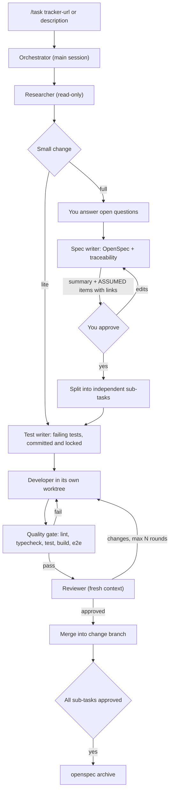

# Concepts: why the loop looks like this

The kit installs a **delivery loop**: a fixed sequence of specialized agents, gates and state files that takes a
task from a ticket to reviewed, merged code. Each design choice below exists to stop a specific way agents fail.

## The loop

## Failure modes and the countermeasure for each

| Failure mode | Countermeasure | Where |
|---|---|---|
| Agent builds the wrong thing confidently | Research brief with verbatim requirements, open questions asked up front | `researcher`, `task-intake` |
| Spec quietly invents scope | Every requirement tagged `[TASK]`, `[REPO]` or `[ASSUMED]`; you approve only the ASSUMED list | `spec-writer`, `spec-traceability`, `openspec/config.yaml` |
| Tests written to match the code (always green) | Tests come from the spec and public interfaces only, written by a different agent, proven RED, committed first | `test-writer` |
| Developer "fixes" tests instead of code | Test paths locked; a pre-tool-use hook blocks edits and reverting git commands | `block-test-edits.mjs`, `settings.json` |
| One agent's mistake confirmed by the next | Separate contexts: the developer never sees the spec, the reviewer sees neither conversation | `developer`, `reviewer` |
| Parallel agents overwrite each other | Waves of sub-tasks with no shared files; each developer in its own git worktree | `subtask-split`, `isolation: worktree` |
| "Done" means "I think it works" | Deterministic quality gate + reviewer APPROVED + gate re-run after merge | `quality-gate`, `task` |
| Long tasks die halfway | `loop.md` state after every phase; `/task resume <id>` | `task` |
| The same correction given every week | `/feedback` turns it into a team rule with severity and role; the reviewer enforces `Must` rules | `feedback-curator` |
| Context files bloat and get ignored | `AGENTS.md` holds only non-obvious constraints, commands, done, pointers | `docs/ai/maintaining.md` |

## Two paths

- **Full**: research → spec + approval → split → per sub-task RED/GREEN/REVIEW → archive. State and specs in
  `openspec/changes/<id>/`, committed.
- **Lite**: for small fixes (one module, no contract change, ~100 lines). Skips the spec; one sub-task goes straight
  through test-writer, developer and reviewer. State in `.loop/<id>/`, gitignored.

## Where you, the human, are in the loop

1. Answer the researcher's open questions (asked once, with defaults).
2. Approve the spec by reading the short "Not from the task" list, not the whole spec.
3. Handle escalations: N review rounds without approval, a test the developer thinks is wrong, a non-trivial merge
   conflict.
4. Give feedback: anything you'd say twice becomes a rule.

## What each tool provides

| Need | Tool |
|---|---|
| Subagents, skills, hooks, worktrees | Claude Code (`.claude/`); Cursor reads the same files through Claude compatibility, plus `.cursor/hooks.json` |
| Structured specs and change folders | [OpenSpec](https://github.com/Fission-AI/OpenSpec) |
| Codebase map for research (optional) | graphify, or plain grep on smaller repos |
| Tasks, standards, team rules | Your tracker, wiki and rules store, through MCP servers, or plain files in the repo |
