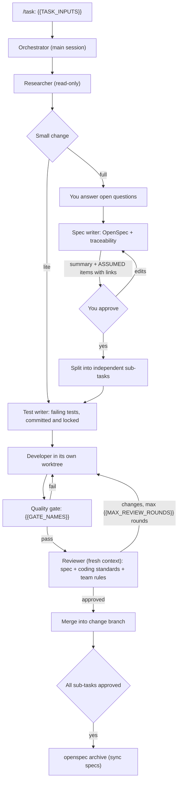

# AI delivery workflow (`/task`)

One command takes a task ({{TASK_INPUTS}}) to reviewed, merged code:

```
<!-- @if tracker=yes -->
/task {{TICKET_KEY_EXAMPLE}}                          # a {{TRACKER_NAME}} task
<!-- @endif -->
/task fix the refund total rounding          # a description
/task resume add-refund-endpoint             # continue an interrupted task
```

<!-- @if cursor=yes -->
It works the same in Claude Code and Cursor: both load the agents from `.claude/agents/` and the skills from
`.claude/skills/`.
<!-- @endif -->

## The loop



## Where you are involved

1. **Open questions** from the researcher, asked all at once with suggested defaults.
2. **Spec approval.** You get a short summary, the list of sub-tasks and a **"Not from the task"** list: every
   requirement the spec writer couldn't trace to the task or the repo, one line each, with a link to the exact
   spec line. That list is the hallucination check; you don't need to read the whole spec unless you want to.
3. **Escalations**: a sub-task stuck after {{MAX_REVIEW_ROUNDS}} review rounds, a test the developer thinks is wrong, a merge conflict
   that isn't trivial.
4. **Feedback.** If you say something that should apply beyond this task ("never use…", "I prefer…"), the
   feedback curator records it in the team rules and proposes an `AGENTS.md` or skill edit. You can also run `/feedback`.

## Rules the loop enforces

- **Tests come first and can't be changed afterwards.** The test writer works from the spec and public
  interfaces only and proves its tests fail. Their paths go into a lock file; `scripts/agent-hooks/block-test-edits.mjs`
  (a pre-tool-use hook) blocks edits to them, and the reviewer re-checks with `git diff`.
- **Separate contexts.** The developer sees the failing tests, not the spec; the reviewer sees neither
  conversation. This stops one agent's mistakes from being "confirmed" by the next.
- **Parallel sub-tasks are isolated.** Independent sub-tasks run at the same time, each developer in its own git
  worktree branched from the change branch (`worktree.baseRef: "head"` in `.claude/settings.json`).
- **Done means approved.** A sub-task is done only when the reviewer approves it and it's merged; the task is done
  only when every sub-task is and the gate passes on the merged branch.

## Lite path

If the researcher estimates a small change ({{LITE_DEFINITION}}), `/task` skips
OpenSpec: one sub-task goes straight through test writer, developer and reviewer. State lives in `.loop/<id>/`
(gitignored). Say "use the full path" to override.

## State and resuming

|              | Full path                                | Lite path                     |
| ------------ | ---------------------------------------- | ----------------------------- |
| State        | `openspec/changes/<id>/loop.md`          | `.loop/<id>/loop.md`          |
| Locked tests | `openspec/changes/<id>/locked-tests.txt` | `.loop/<id>/locked-tests.txt` |
| Research     | `openspec/changes/<id>/research.md`      | —                             |
| Traceability | `openspec/changes/<id>/traceability.md`  | —                             |

`loop.md` records each sub-task's status, RED commit, developer branch, review rounds and verdicts, so
`/task resume <id>` continues from the last finished step.

## Team rules and standards

`AGENTS.md` › External references holds the links:

- Coding standards: the reviewer checks diffs against them.
- Team rules: the feedback curator writes them; each agent reads only the rows for its role (Active, sorted by
  severity). Rules the curator inferred land as `Proposed` until a human sets them to `Active`.
<!-- @if rules=notion -->

Each role reads its own saved Notion view, so nobody scans the database. To add a role or repo, duplicate an agent
view in Notion, change its filters and add it to the table in `AGENTS.md`. The Notion MCP server must be connected
in the tool you use.
<!-- @endif -->
